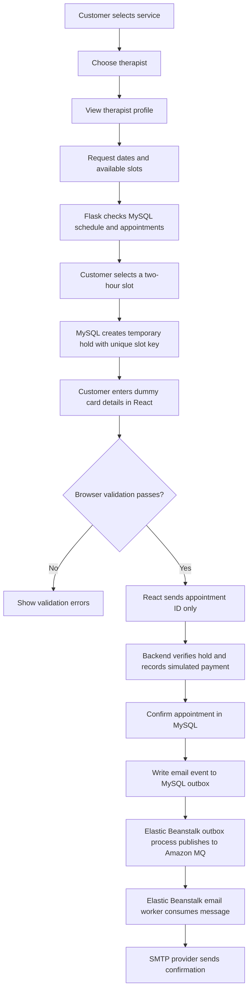

# Booking and AWS messaging flow

The card number, expiry and CVV are validated in the browser only. They are never sent to Flask, stored in MySQL, logged or published to RabbitMQ. This is a portfolio simulation: no bank, card network or payment provider is contacted and no money is charged.

Memcached caches products, categories, services and therapist catalogue/profile data. It does not reserve appointment slots and is never the authority for availability or payment success. RDS MySQL remains authoritative.

The outbox publisher and queue consumer are separate Elastic Beanstalk Procfile processes. RabbitMQ messages are persistent. Delivery is at-least-once, so downstream email handling should be made idempotent before adapting this design for a high-volume production system.
